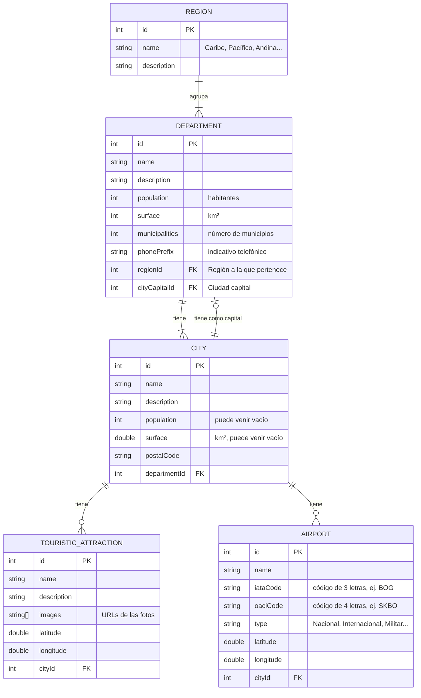

# 🧭 Rumbo Colombia

**Tu guía para recorrer Colombia, incluso sin señal.**

Diseño y arquitectura de una aplicación móvil Android que muestra los atractivos turísticos de Colombia organizados por región, departamento y ciudad, consumiendo la API pública [API Colombia](https://api-colombia.com).

> Proyecto Integrador · Aplicaciones Móviles Android · SENA, Tecnología en Análisis y Desarrollo de Software · Ficha 3229209 · Grupo 2
>
> Este repositorio contiene **solo el diseño** de la app y el **proyecto base** generado por Android Studio. Todavía no tiene código de la aplicación: todo lo que se planificó está documentado en este README.

## Integrantes

| Integrante | Rol en el equipo |
|---|---|
| Manuela Córdoba Robledo | Líder del equipo |
| Davier Andrés Quinto Bejarano | Integrante |

## Contenido

1. [Idea y API elegida](#1-idea-y-api-elegida) (Hito 1)
2. [Modelo de datos](#2-modelo-de-datos) (Hito 2)
3. Pantallas y flujo de navegación (Hito 3) · *pendiente*
4. Arquitectura y endpoints (Hito 4) · *pendiente*
5. Proyecto base en Android Studio (Hito 5) · *pendiente*
6. Video de presentación (Hito 6) · *pendiente*
7. Cómo trabajamos (GitHub Flow) · *pendiente*

---

## 1. Idea y API elegida

### Elevator pitch

**Rumbo Colombia** es una guía turística para el celular que ayuda a viajeros nacionales y extranjeros a descubrir los atractivos turísticos de Colombia, organizados por **región, departamento y ciudad**.

**El problema:** la información turística está repartida en muchas páginas, y en las carreteras y los pueblos casi nunca hay buena señal. El viajero termina sin saber qué visitar ni cómo llegar.

**La solución:** una app que muestra cada atracción con fotos, descripción y ubicación en el mapa, indica el **aeropuerto más cercano** para planear la llegada y **guarda la información en el celular** para consultarla sin internet.

### ¿Por qué una app móvil y no una página web?

1. **El viajero está en movimiento.** El celular es lo único que lleva siempre consigo durante el viaje.
2. **Ubicación y mapas.** Cada atracción tiene latitud y longitud, así que la app puede abrirla en el mapa del celular y calcular qué tan cerca queda.
3. **Sin señal no hay web.** En zonas rurales la conexión falla; la app guarda la región que el usuario va a visitar para consultarla offline.
4. **Avisos.** Una app puede recordarle al viajero los lugares que guardó, algo que una página web no hace bien.

### API elegida: API Colombia

| | |
|---|---|
| **Nombre** | API Colombia |
| **URL base** | `https://api-colombia.com/api/v1/` |
| **Documentación** | [api-colombia.com/swagger](https://api-colombia.com/swagger) |
| **Autenticación** | No necesita API key: es pública y gratuita |
| **Formato** | JSON, con los textos en español |

**Por qué la elegimos:** tiene datos reales de Colombia, en español y sin costo, y sus recursos están relacionados entre sí (una región tiene departamentos, un departamento tiene ciudades y una ciudad tiene atracciones y aeropuertos). Eso nos permite diseñar un modelo de datos completo y una navegación natural de lo general a lo particular.

### Recursos de la API que usará la app

| Recurso | Endpoint base | Cantidad aprox. | Para qué lo usa la app |
|---|---|---|---|
| **Región** | `/Region` | 6 | Explorar el país por regiones (Caribe, Pacífico, Andina…) |
| **Departamento** | `/Department` | 33 | Agrupar las ciudades de cada región |
| **Ciudad** | `/City` | 1.123 | Ubicar cada atracción y buscar destinos por nombre |
| **Atracción turística** | `/TouristicAttraction` | 41 | Lista principal y detalle: fotos, descripción y coordenadas |
| **Aeropuerto** | `/Airport` | 52 | Mostrar el aeropuerto más cercano para llegar al destino |

*Cantidades consultadas en la API el 19 de octubre de 2026.*

---

## 2. Modelo de datos

Diagrama entidad-relación de los 5 recursos que llegan de API Colombia, con los atributos que usará la app. Los nombres de las entidades y los campos son los mismos del JSON de la API, para que el mapeo a las clases de Kotlin sea directo.

### Relaciones

| Relación | Tipo | Cómo se lee |
|---|---|---|
| Región → Departamento | **1 : N** | Una región agrupa uno o varios departamentos; cada departamento pertenece a una sola región (`regionId`). |
| Departamento → Ciudad | **1 : N** | Un departamento tiene una o varias ciudades; cada ciudad pertenece a un solo departamento (`departmentId`). |
| Departamento → Ciudad capital | **1 : 1** | Cada departamento tiene exactamente una ciudad capital (`cityCapitalId`); una ciudad es capital de máximo un departamento. |
| Ciudad → Atracción turística | **1 : N** | Una ciudad puede tener cero o varias atracciones; cada atracción queda en una sola ciudad (`cityId`). |
| Ciudad → Aeropuerto | **1 : N** | Una ciudad puede tener cero o varios aeropuertos; cada aeropuerto queda en una sola ciudad (`cityId`). |

### Decisiones del modelo

- **Solo los campos que la app necesita.** La API trae más información (presidentes, emisoras, reservas indígenas…), pero se dejó por fuera porque ninguna pantalla la usa.
- **Coordenadas como `double`.** Atracciones y aeropuertos traen `latitude` y `longitude`; con ellas la app abre el mapa y calcula cuál es el aeropuerto más cercano a cada atracción.
- **Campos que pueden venir vacíos.** Algunas ciudades no traen `population` ni `surface`; en Kotlin se modelarán como tipos *nullable* (`Int?`, `Double?`) para que la app no falle.
- **Un detalle de la API:** en el JSON de aeropuertos el campo del departamento se llama `deparmentId` (sin la "t"). La app usará el `cityId`, que es el dato confiable, y llega al departamento a través de la ciudad.
