# 🧭 Rumbo Colombia

**Tu guía para recorrer Colombia, incluso sin señal.**

Diseño y arquitectura de una aplicación móvil Android que muestra los atractivos turísticos de Colombia organizados por región, departamento y ciudad, consumiendo la API pública [API Colombia](https://api-colombia.com).

> Proyecto Integrador · Aplicaciones Móviles Android · SENA, Tecnología en Análisis y Desarrollo de Software · Ficha 3229209 · Grupo 2
>
> Este repositorio empezó con **solo el diseño** de la app y el **proyecto base** generado por Android Studio (secciones 1 a 7). Después, siguiendo la documentación del curso, se construyó la app paso a paso (secciones 8 a 14): hoy consume datos reales de API Colombia con arquitectura MVVM y guarda los datos en el celular con Room. Las secciones 15 y 16 explican la elección de tecnologías y las conclusiones.

## Integrantes

| Integrante | Rol en el equipo | Funciones |
|---|---|---|
| Manuela Córdoba Robledo | Líder y desarrolladora | Crea el repositorio, programa la app, abre las ramas y los Pull Requests y mantiene este README. |
| Davier Andrés Quinto Bejarano | Revisor de código | Revisa cada Pull Request, lo aprueba y lo une a `main`, y verifica que siga la documentación del curso. |

**Objetivo central:** que cualquier persona encuentre los lugares turísticos de Colombia, sepa en qué ciudad, departamento y región quedan y cuál es el aeropuerto más cercano, incluso sin internet.

## Contenido

1. [Idea y API elegida](#1-idea-y-api-elegida) (Hito 1)
2. [Modelo de datos](#2-modelo-de-datos) (Hito 2)
3. [Pantallas y flujo de navegación](#3-pantallas-y-flujo-de-navegación) (Hito 3)
4. [Arquitectura y endpoints](#4-arquitectura-y-endpoints) (Hito 4)
5. [Proyecto base en Android Studio](#5-proyecto-base-en-android-studio) (Hito 5)
6. [Presentación (exposición en vivo)](#6-presentación-exposición-en-vivo) (Hito 6)
7. [Cómo trabajamos (GitHub Flow)](#7-cómo-trabajamos-github-flow) (Hito 7)
8. [Fase 2: vistas y modelo en código](#8-fase-2-vistas-y-modelo-en-código)
9. [Fase 3: datos reales de API Colombia](#9-fase-3-datos-reales-de-api-colombia)
10. [Fase 4: navegación type-safe](#10-fase-4-navegación-type-safe)
11. [Capa de Repositorio](#11-capa-de-repositorio)
12. [Capa de Red (Network Layer)](#12-capa-de-red-network-layer)
13. [Estructura según la Referencia de Avance](#13-estructura-según-la-referencia-de-avance)
14. [Capa de Datos local con Room](#14-capa-de-datos-local-con-room)
15. [Justificación tecnológica](#15-justificación-tecnológica)
16. [Conclusiones y aprendizajes](#16-conclusiones-y-aprendizajes)

---

## 1. Idea y API elegida

### Elevator pitch

**Rumbo Colombia** es una guía turística para el celular que ayuda a viajeros nacionales y extranjeros a descubrir los atractivos turísticos de Colombia, organizados por **región, departamento y ciudad**.

**El problema:** la información turística está repartida en muchas páginas, y en las carreteras y los pueblos casi nunca hay buena señal. El viajero termina sin saber qué visitar ni cómo llegar.

**La solución:** una app que muestra cada atracción con fotos, descripción y ubicación en el mapa, indica el **aeropuerto más cercano** para planear la llegada y **guarda la información en el celular** para consultarla sin internet.

### ¿Por qué una app móvil y no una página web?

1. **El viajero está en movimiento.** El celular es lo único que lleva siempre consigo durante el viaje.
2. **Ubicación y mapas.** Cada atracción tiene latitud y longitud, así que la app puede abrirla en el mapa del celular y calcular qué tan cerca queda.
3. **Sin señal no hay web.** En zonas rurales la conexión falla; la app guarda la región que el usuario va a visitar para consultarla offline.
4. **Avisos.** Una app puede recordarle al viajero los lugares que guardó, algo que una página web no hace bien.

### API elegida: API Colombia

| | |
|---|---|
| **Nombre** | API Colombia |
| **URL base** | `https://api-colombia.com/api/v1/` |
| **Documentación** | [api-colombia.com/swagger](https://api-colombia.com/swagger) |
| **Autenticación** | No necesita API key: es pública y gratuita |
| **Formato** | JSON, con los textos en español |

**Por qué la elegimos:** tiene datos reales de Colombia, en español y sin costo, y sus recursos están relacionados entre sí (una región tiene departamentos, un departamento tiene ciudades y una ciudad tiene atracciones y aeropuertos). Eso nos permite diseñar un modelo de datos completo y una navegación natural de lo general a lo particular.

### Recursos de la API que usará la app

| Recurso | Endpoint base | Cantidad aprox. | Para qué lo usa la app |
|---|---|---|---|
| **Región** | `/Region` | 6 | Explorar el país por regiones (Caribe, Pacífico, Andina…) |
| **Departamento** | `/Department` | 33 | Agrupar las ciudades de cada región |
| **Ciudad** | `/City` | 1.123 | Ubicar cada atracción y buscar destinos por nombre |
| **Atracción turística** | `/TouristicAttraction` | 41 | Lista principal y detalle: fotos, descripción y coordenadas |
| **Aeropuerto** | `/Airport` | 52 | Mostrar el aeropuerto más cercano para llegar al destino |

*Cantidades consultadas en la API el 19 de octubre de 2026.*

---

## 2. Modelo de datos

Diagrama entidad-relación de los 5 recursos que llegan de API Colombia, con los atributos que usará la app. Los nombres de las entidades y los campos son los mismos del JSON de la API, para que el mapeo a las clases de Kotlin sea directo.

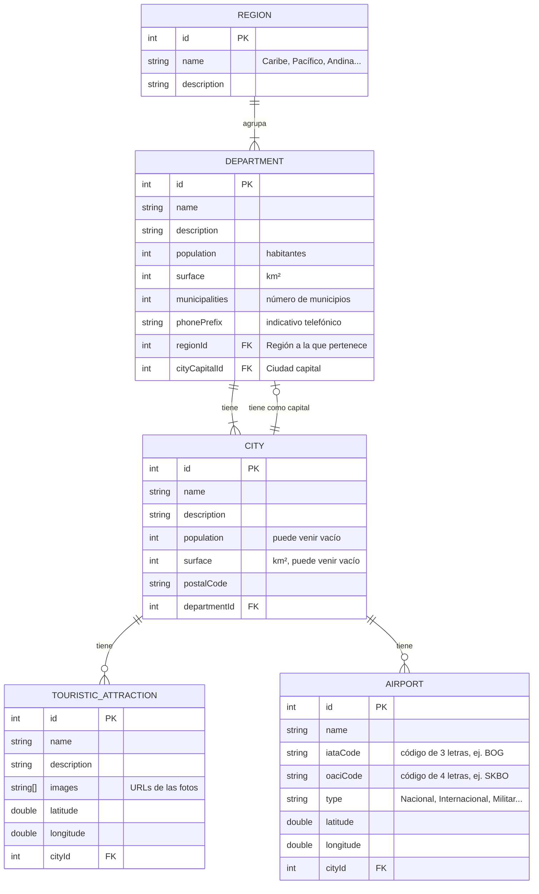

### Relaciones

| Relación | Tipo | Cómo se lee |
|---|---|---|
| Región → Departamento | **1 : N** | Una región agrupa uno o varios departamentos; cada departamento pertenece a una sola región (`regionId`). |
| Departamento → Ciudad | **1 : N** | Un departamento tiene una o varias ciudades; cada ciudad pertenece a un solo departamento (`departmentId`). |
| Departamento → Ciudad capital | **1 : 1** | Cada departamento tiene exactamente una ciudad capital (`cityCapitalId`); una ciudad es capital de máximo un departamento. |
| Ciudad → Atracción turística | **1 : N** | Una ciudad puede tener cero o varias atracciones; cada atracción queda en una sola ciudad (`cityId`). |
| Ciudad → Aeropuerto | **1 : N** | Una ciudad puede tener cero o varios aeropuertos; cada aeropuerto queda en una sola ciudad (`cityId`). |

### Decisiones del modelo

- **Solo los campos que la app necesita.** La API trae más información (presidentes, emisoras, reservas indígenas…), pero se dejó por fuera porque ninguna pantalla la usa.
- **Coordenadas como `double`.** Atracciones y aeropuertos traen `latitude` y `longitude`; con ellas la app abre el mapa y calcula cuál es el aeropuerto más cercano a cada atracción.
- **Campos que pueden venir vacíos.** La mayoría de las ciudades (1.060 de 1.123) no traen `population` ni `surface`; en Kotlin se modelarán como tipos *nullable* (`Int?`) y la pantalla solo los mostrará cuando existan, para que la app no falle.
- **Un detalle de la API:** en el JSON de aeropuertos el campo del departamento se llama `deparmentId` (sin la "t"). La app usará el `cityId`, que es el dato confiable, y llega al departamento a través de la ciudad.

---

## 3. Pantallas y flujo de navegación

Las pantallas se diseñaron en **Google Stitch** como un prototipo interactivo: se puede tocar una tarjeta para abrir el detalle, usar la barra inferior para cambiar de pantalla y volver atrás.

🔗 **Prototipo en Google Stitch:** [stitch.withgoogle.com/projects/10235196442344271062](https://stitch.withgoogle.com/projects/10235196442344271062)

**Sistema de diseño:** Material Design 3 con los colores de la bandera de Colombia usados como paleta: azul profundo como color principal, amarillo como acento y rojo para estados importantes, sobre fondo claro.

### Flujo de navegación

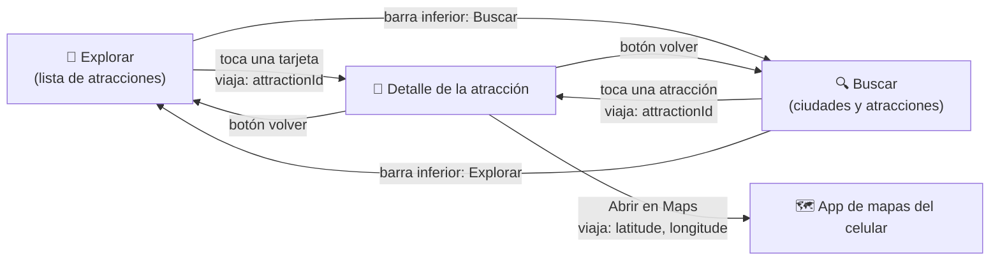

El único dato que viaja entre pantallas es el **`attractionId`**: la pantalla de detalle lo recibe y con él pide la información completa a la API. Así cada pantalla es independiente y el detalle se puede abrir desde Explorar o desde Buscar.

### Pantalla 1 · Explorar (lista principal)

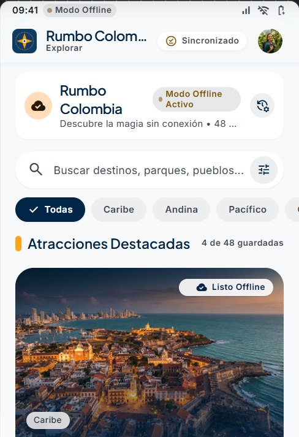

| | |
|---|---|
| **Qué muestra** | Las atracciones turísticas en tarjetas con foto, nombre, ciudad y departamento. Arriba, una barra de búsqueda rápida y chips para filtrar por región. Cada tarjeta indica si ya está guardada para ver sin internet. |
| **De dónde salen los datos** | `GET /TouristicAttraction` (lista con la ciudad de cada atracción). `GET /Department` y `GET /Region` para mostrar el departamento y filtrar por región. |
| **Acciones del usuario** | Tocar una tarjeta → abre el **Detalle**. Tocar un chip de región → filtra la lista. Tocar el ícono de guardar → la guarda en el celular. Barra inferior → cambia a **Buscar**. |
| **Datos que envía** | `attractionId` al Detalle. |

### Pantalla 2 · Detalle de la atracción

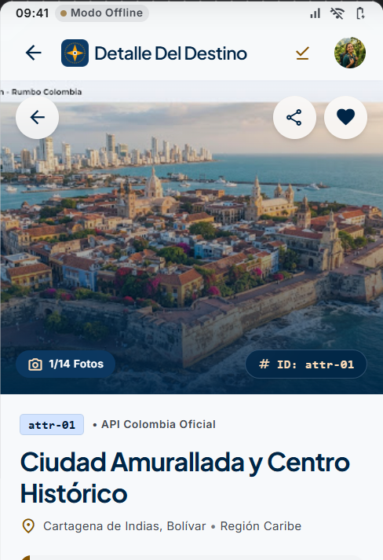 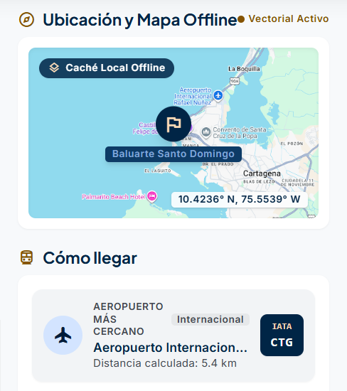

| | |
|---|---|
| **Qué muestra** | Foto grande, nombre, ciudad, departamento y región, descripción completa, un mapa con la ubicación y la tarjeta **"Cómo llegar"** con el aeropuerto más cercano (nombre, código IATA, tipo y distancia en km). |
| **De dónde salen los datos** | `GET /TouristicAttraction/{id}` (detalle con fotos y coordenadas). `GET /Airport` para calcular el aeropuerto más cercano a partir de la latitud y longitud de la atracción y de cada aeropuerto. |
| **Acciones del usuario** | Volver → regresa a la pantalla anterior. **Abrir en Maps** → abre la app de mapas del celular con las coordenadas. **Guardar sin internet** → guarda la atracción en el celular. Compartir. |
| **Datos que recibe** | `attractionId`. |

### Pantalla 3 · Buscar

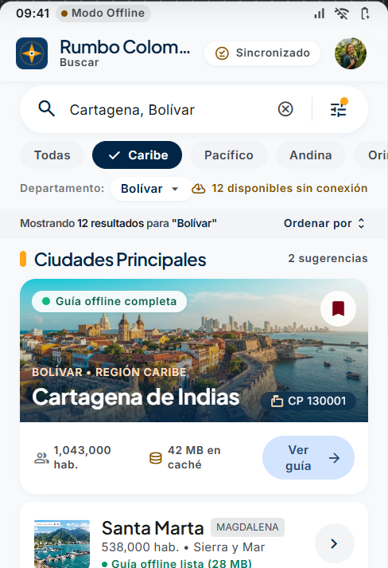

| | |
|---|---|
| **Qué muestra** | Un campo de búsqueda grande, filtros por región y departamento, y los resultados separados en **ciudades** (con departamento, población cuando existe y código postal) y **atracciones** (con foto pequeña). |
| **De dónde salen los datos** | `GET /City/search/{texto}` y `GET /TouristicAttraction/search/{texto}`. Para el filtro por departamento: `GET /Region/{id}/departments`. |
| **Acciones del usuario** | Escribir → busca ciudades y atracciones. Elegir región o departamento → filtra. Tocar una atracción → abre el **Detalle**. Barra inferior → vuelve a **Explorar**. |
| **Datos que envía** | `attractionId` al Detalle. |

### Notas del prototipo

- **Todo lo que muestran las pantallas sale de API Colombia**, menos lo que calcula la app (la distancia al aeropuerto y el espacio que ocupa lo guardado en el celular). Al diseñar se quitaron a propósito las estrellas, reseñas, precios y audioguías que Stitch proponía, porque la API no tiene esos datos.
- Algunos textos de apoyo del prototipo, como las indicaciones de transporte terrestre en "Cómo llegar" o etiquetas como "Mejor temporada", son de ejemplo visual. En la app se reemplazarán por datos de la API o no se mostrarán.
- La tercera opción de la barra inferior, **Guardados**, queda planeada para una siguiente versión: mostraría las atracciones guardadas para ver sin internet.

---

## 4. Arquitectura y endpoints

La app se va a organizar con el patrón **MVVM**: cada pantalla solo dibuja lo que le da su ViewModel, el ViewModel le pide los datos al repositorio y el repositorio decide si los trae de internet (API Colombia) o del celular (lo guardado para ver sin señal).

### Diagrama de arquitectura

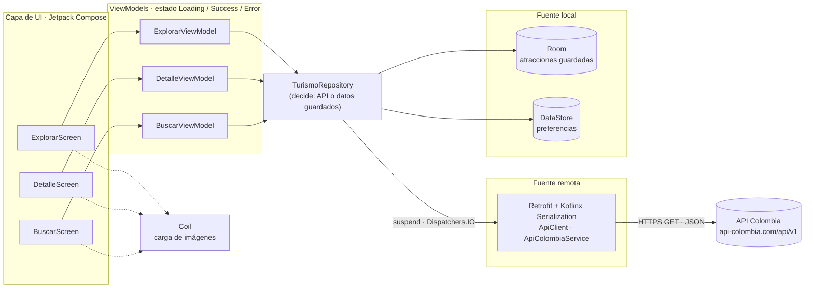

### Cómo funciona cada capa

| Capa | Qué hace | Tecnología |
|---|---|---|
| **UI** | Dibuja las 3 pantallas y le avisa al ViewModel lo que hace el usuario (tocar una tarjeta, escribir en el buscador). No sabe de dónde vienen los datos. | Jetpack Compose, Material 3, Navigation Compose |
| **ViewModel** | Guarda el estado de cada pantalla y sobrevive cuando se gira el celular. Lanza las consultas en una corrutina. | ViewModel + `StateFlow` |
| **Repositorio** | Es el único que habla con las fuentes de datos. Si hay internet consulta la API; si no, devuelve lo guardado en Room. | Kotlin Coroutines (`suspend`, `Dispatchers.IO`) |
| **Fuente remota** | Hace las peticiones HTTP a API Colombia y convierte el JSON en objetos de Kotlin. | Retrofit + Kotlinx Serialization + OkHttp (cambiado de Gson en la [sección 12](#12-capa-de-red-network-layer)) |
| **Fuente local** | Guarda las atracciones que el usuario marca para ver sin señal, y preferencias como la última región elegida. | Room y DataStore |
| **Imágenes** | Descarga las fotos de las atracciones y las guarda en caché. | Coil |

### Estados de cada pantalla

Cada ViewModel expone uno de estos tres estados y la pantalla se dibuja según cuál sea:

| Estado | Qué ve el usuario |
|---|---|
| **Loading** | Un indicador de carga mientras llega la respuesta. |
| **Success** | La lista, el detalle o los resultados de la búsqueda. |
| **Error** | Un mensaje claro (por ejemplo "Sin conexión") con un botón **Reintentar**. Si la atracción está guardada en el celular, se muestra igual desde Room. |

### Seguridad

- **API Colombia no necesita API Key**: es pública y solo de lectura, así que no hay ninguna clave que proteger.
- Si en una versión futura se usa un servicio con clave (por ejemplo un mapa), la clave irá en `local.properties`, que ya está en el `.gitignore`, y se leerá con `BuildConfig`. **Nunca se sube al repositorio.**
- Todas las peticiones van por **HTTPS**.

### Endpoints que consumirá la app

URL base: `https://api-colombia.com/api/v1/`

| Endpoint | Método HTTP | Parámetros | Propósito en la app |
|---|---|---|---|
| `/TouristicAttraction` | GET | — | Lista de atracciones para la pantalla **Explorar**. |
| `/TouristicAttraction/{id}` | GET | `id` (path): id de la atracción | Información completa, fotos y coordenadas para la pantalla **Detalle**. |
| `/TouristicAttraction/search/{keyword}` | GET | `keyword` (path): texto que escribe el usuario | Atracciones que coinciden con la búsqueda en **Buscar**. |
| `/City/search/{keyword}` | GET | `keyword` (path): texto que escribe el usuario | Ciudades que coinciden con la búsqueda en **Buscar**. |
| `/Region` | GET | — | Las 6 regiones para los chips de filtro en **Explorar** y **Buscar**. |
| `/Region/{id}/departments` | GET | `id` (path): id de la región | Departamentos de una región para el filtro de **Buscar**. |
| `/Department` | GET | — | Nombre del departamento de cada atracción en las tarjetas de **Explorar**. |
| `/Airport` | GET | — | Aeropuertos con sus coordenadas para calcular el más cercano en **Detalle** ("Cómo llegar"). |

> Todos los endpoints se probaron el 20 de octubre de 2026 y responden `200 OK` con JSON.

### Estructura de carpetas planeada

Esto fue el plan inicial. El 27 de octubre, al empezar el código (sección 8), se ajustó a la estructura de la guía de la Sesión 4 (`data/` y `presentation/`); los nombres de los ViewModels y del Repositorio se mantienen. La estructura actual, igual a la Referencia de Avance del curso, está en la [sección 13](#13-estructura-según-la-referencia-de-avance) y en `docs/tutorial_arquitectura.md`.

```
com.rumbocolombia.android
├── data
│   ├── remote      → ApiColombiaService (Retrofit) y los DTO del JSON
│   ├── local       → Room (atracciones guardadas) y DataStore
│   └── repository  → TurismoRepository
├── ui
│   ├── explorar    → ExplorarScreen + ExplorarViewModel
│   ├── detalle     → DetalleScreen + DetalleViewModel
│   ├── buscar      → BuscarScreen + BuscarViewModel
│   └── theme       → colores y tipografía
└── MainActivity.kt
```


---

## 5. Proyecto base en Android Studio

El proyecto se creó en Android Studio con la plantilla **Empty Activity** y se subió **tal como lo generó el asistente**, sin agregar ni quitar nada. En ese momento todo el diseño de la app vivía en este README; el código empezó después, en la sección 8.

| Dato | Valor |
|---|---|
| Plantilla | Empty Activity |
| Lenguaje | Kotlin |
| Interfaz | Jetpack Compose (Material 3) |
| Configuración de Gradle | Kotlin DSL (`build.gradle.kts`) |
| Paquete | `com.rumbocolombia.android` |
| SDK mínimo | API 24 (Android 7.0) |
| Commit inicial | [`d8bee3d`](https://github.com/robledocordoba123-cmyk/android-design-rumbocolombia/commit/d8bee3ddcdefd81416af99555b9ba5d766210cd9) · 19 de octubre de 2026 |

### La app corriendo en el emulador

El proyecto base compila y se ejecuta sin errores en el emulador de Android Studio (Medium Phone). Muestra el texto de ejemplo que trae la plantilla:

<p align="center">
  
</p>

### Qué traía el proyecto base (commit inicial)

- `MainActivity.kt` con el `Greeting("Android")` de la plantilla.
- `ui/theme/` con `Color.kt`, `Theme.kt` y `Type.kt` generados por Android Studio.
- Las pruebas de ejemplo (`ExampleUnitTest` y `ExampleInstrumentedTest`).
- **No** tenía data classes, ViewModels, llamadas a la API ni pantallas propias. Hasta el Hito 7 los únicos archivos que cambiaron fueron este README y las imágenes de la carpeta `docs/`; el código de la app se agregó desde la sección 8.

---

## 6. Presentación (exposición en vivo)

El docente indicó que la presentación se hace como **exposición en vivo de 10 minutos** en clase, en lugar del video. Hablan los dos integrantes por igual:

| Minuto | Quién | Qué se muestra |
|---|---|---|
| 0 – 3 | Manuela | Idea, roles y la app corriendo en el emulador (también sin internet) |
| 3 – 7:30 | Davier | Las capas en Android Studio, la justificación tecnológica (sección 15) y los Pull Requests que revisó |
| 7:30 – 9 | Manuela | README, retos, aprendizajes y conclusiones (sección 16) |
| 9 – 10 | Los dos | Preguntas del docente |

El guion que se preparó para el video está en [docs/GUION_VIDEO.md](docs/GUION_VIDEO.md).

---

## 7. Cómo trabajamos (GitHub Flow)

Usamos **GitHub Flow**: `main` siempre tiene la versión revisada, y cada hito se trabaja en su propia rama y entra a `main` solo por medio de un Pull Request aprobado.

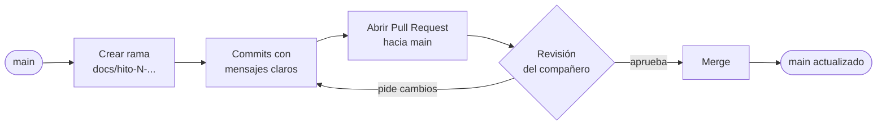

### Reglas que seguimos

- **Nadie trabaja directo en `main`.** El único commit en `main` sin Pull Request es el del proyecto base generado por Android Studio.
- **Una rama por hito o funcionalidad**: `docs/...` para documentación (por ejemplo `docs/hito-2-modelo-datos`) y `feature/...` para código (por ejemplo `feature/capa-repositorio`).
- **Mensajes de commit en español** que empiezan por el hito y dicen qué se hizo: `Hito 4: arquitectura MVVM en Mermaid y tabla de endpoints`.
- **Cada Pull Request lo revisa el otro integrante**, que lo aprueba antes de hacer el merge.

### Historial de Pull Requests

| PR | Rama | Qué agregó | Revisión |
|---|---|---|---|
| [#1](https://github.com/robledocordoba123-cmyk/android-design-rumbocolombia/pull/1) | `docs/hito-1-idea-y-api` | Hito 1: idea, elevator pitch y API elegida | Aprobado por Davier |
| [#2](https://github.com/robledocordoba123-cmyk/android-design-rumbocolombia/pull/2) | `docs/hito-2-modelo-datos` | Hito 2: diagrama ER (se unió por error a la rama del Hito 1) | Aprobado por Davier |
| [#3](https://github.com/robledocordoba123-cmyk/android-design-rumbocolombia/pull/3) | `docs/hito-2-modelo-datos` | Hito 2 llevado a `main` para corregir lo anterior | Aprobado por Davier |
| [#4](https://github.com/robledocordoba123-cmyk/android-design-rumbocolombia/pull/4) | `docs/hito-3-pantallas` | Hito 3: pantallas en Google Stitch y flujo de navegación | Aprobado por Davier |
| [#5](https://github.com/robledocordoba123-cmyk/android-design-rumbocolombia/pull/5) | `docs/hito-4-arquitectura` | Hito 4: arquitectura MVVM y tabla de endpoints | Aprobado por Davier |
| [#6](https://github.com/robledocordoba123-cmyk/android-design-rumbocolombia/pull/6) | `docs/hito-5-proyecto-base` | Hito 5: proyecto base con captura | Unido por Davier |
| [#7](https://github.com/robledocordoba123-cmyk/android-design-rumbocolombia/pull/7) | `docs/hito-6-video` | Hito 6: guion y sección del video | Unido por Davier |
| [#8](https://github.com/robledocordoba123-cmyk/android-design-rumbocolombia/pull/8) | `docs/hito-7-github-flow` | Hito 7: esta sección | Unido por Davier |
| [#9](https://github.com/robledocordoba123-cmyk/android-design-rumbocolombia/pull/9) | `feature/fase-2-vistas-y-modelo` | Fase 2: modelo, repositorio, ViewModel y vistas | Unido por Manuela (Davier ausente por fuerza mayor) |
| [#10](https://github.com/robledocordoba123-cmyk/android-design-rumbocolombia/pull/10) | `feature/fase-2-viewmodel-por-pantalla` | Fase 2: un ViewModel por pantalla y botón Guardar | Unido por Manuela (Davier ausente por fuerza mayor) |
| [#11](https://github.com/robledocordoba123-cmyk/android-design-rumbocolombia/pull/11) | `feature/fase-2-previews` | Fase 2: `@Preview` de las 3 pantallas | Unido por Manuela (Davier ausente por fuerza mayor) |
| [#12](https://github.com/robledocordoba123-cmyk/android-design-rumbocolombia/pull/12) | `feature/fase-3-api-real-retrofit` | Fase 3: datos reales con Retrofit, estados y fotos con Coil | Unido por Manuela (Davier ausente por fuerza mayor) |
| [#13](https://github.com/robledocordoba123-cmyk/android-design-rumbocolombia/pull/13) | `feature/fase-4-navegacion-type-safe` | Fase 4: navegación type-safe con Navigation Compose | Aprobado por Davier |
| [#14](https://github.com/robledocordoba123-cmyk/android-design-rumbocolombia/pull/14) | `docs/tabla-pr-13` | README: fila del PR #13 en este historial | Aprobado por Davier |
| [#15](https://github.com/robledocordoba123-cmyk/android-design-rumbocolombia/pull/15) | `feature/fase-4-nueva-vista-perfil` | Fase 4: nueva vista Perfil siguiendo la guía de 4 pasos | Aprobado por Davier |
| [#16](https://github.com/robledocordoba123-cmyk/android-design-rumbocolombia/pull/16) | `docs/tabla-pr-14-15` | README: filas de los PR #14 y #15 en este historial | Aprobado por Davier |
| [#17](https://github.com/robledocordoba123-cmyk/android-design-rumbocolombia/pull/17) | `feature/capa-repositorio` | Capa de Repositorio: interfaz + implementación con `Result` | Aprobado por Davier |
| [#18](https://github.com/robledocordoba123-cmyk/android-design-rumbocolombia/pull/18) | `feature/capa-de-red` | Capa de Red: `ApiClient` con Kotlinx Serialization y OkHttp Logging | Aprobado por Davier |
| [#19](https://github.com/robledocordoba123-cmyk/android-design-rumbocolombia/pull/19) | `feature/referencia-avance` | Estructura igual a la Referencia de Avance 1 y 2: carpeta `navigation/`, un archivo por componente y `docs/` | Aprobado por Davier |
| [#20](https://github.com/robledocordoba123-cmyk/android-design-rumbocolombia/pull/20) | `docs/tabla-pr-17-19` | README: PR #17, #18 y #19 aprobados en este historial | Aprobado por Davier |
| [#21](https://github.com/robledocordoba123-cmyk/android-design-rumbocolombia/pull/21) | `docs/arquitectura-kotlinx` | README: arquitectura con Kotlinx Serialization en la sección 4 | Aprobado por Davier |
| [#22](https://github.com/robledocordoba123-cmyk/android-design-rumbocolombia/pull/22) | `docs/readme-al-dia` | README al día: índice, secciones 11 a 13 y tabla de PR | Unido por Davier |
| [#23](https://github.com/robledocordoba123-cmyk/android-design-rumbocolombia/pull/23) | `feature/persistencia-room` | Capa de Datos local con Room y secciones 14 a 16 | Unido por Davier |

### Lo que aprendimos

Al principio abrimos el PR del Hito 2 **sobre la rama del Hito 1** en lugar de `main`. Cuando se unió el Hito 1, el Hito 2 terminó en una rama que ya no se usaba y no llegó a `main`. Lo corregimos con el PR #3, y desde entonces **cada rama nueva sale de `main` actualizado** y cada Pull Request apunta a `main`.

---

## 8. Fase 2: vistas y modelo en código

> **Nota:** en esta fase la app usaba `DatosDeEjemplo.kt`, una lista escrita a mano con datos copiados de la API. En la **Fase 3 (sección 9)** ese archivo se eliminó y ahora todos los datos llegan de API Colombia con Retrofit.

En la clase del 27 de octubre el instructor pidió avanzar el proyecto con la documentación de la Sesión 4 (MVVM): **modelo de datos, ViewModel y vistas**, y que el proyecto compile. Seguimos la "receta de 4 pasos" de la guía (modelo → ViewModel → pantalla → probar en `MainActivity`) y la estructura de carpetas del tema *ViewModel y capas de la app*.

```
com.rumbocolombia.android/
├── data/
│   ├── dto/            Modelos.kt (las 5 data class)
│   └── repository/     TurismoRepository.kt, DatosDeEjemplo.kt (eliminado en la Fase 3)
├── presentation/
│   ├── viewmodel/      ExplorarViewModel.kt, DetalleViewModel.kt, BuscarViewModel.kt
│   ├── screens/        ExplorarScreen.kt, DetalleScreen.kt, BuscarScreen.kt
│   └── components/     Componentes.kt (tarjeta, fila y foto reutilizables)
├── ui/theme/           (viene por defecto)
└── MainActivity.kt
```

| Capa | Archivo | Qué hace |
|---|---|---|
| **Modelo** | `data/dto/Modelos.kt` | Las 5 data class del diagrama ER: `Region`, `Department`, `City`, `TouristicAttraction` y `Airport`, con los mismos campos de la API. `population` y `surface` de la ciudad son `Int?` porque pueden venir vacíos. |
| **Repositorio** | `data/repository/TurismoRepository.kt` | El mismo `TurismoRepository` del diagrama de la sección 4. Les entrega los datos a los 3 ViewModels; por ahora los toma de `DatosDeEjemplo.kt` (2 regiones, 5 departamentos, 6 ciudades, 7 atracciones y 6 aeropuertos copiados de API Colombia). Calcula el aeropuerto más cercano (fórmula de Haversine) y guarda la lista de atracciones guardadas con `guardarAtraccion` y `eliminarGuardada`. |
| **ViewModels** | `presentation/viewmodel/` | Uno por pantalla, como en el diagrama de la sección 4 y en la guía: `ExplorarViewModel` (lista y filtro por región), `DetalleViewModel` (atracción, aeropuerto cercano y botón Guardar) y `BuscarViewModel` (resultados). Todos usan `MutableStateFlow` privado y `StateFlow` público. |
| **Vistas** | `presentation/screens/` y `presentation/components/` | Las 3 pantallas diseñadas en Stitch, hechas en Jetpack Compose. Reciben su ViewModel con `viewModel()` y lo observan con `collectAsState()`. El texto que se escribe en Buscar es estado temporal de la pantalla con `remember { mutableStateOf("") }`. |
| **Navegación** | `MainActivity.kt` | Barra inferior Explorar / Buscar; al tocar una atracción se abre el Detalle con su `attractionId`, igual que en el flujo de la sección 3. |

Dependencias nuevas: `lifecycle-viewmodel-compose` (para `viewModel()`) y `material-icons-extended` (íconos).

Cada pantalla tiene su **`@Preview`**, como en la guía de la Sesión 1: en Android Studio se abre el archivo de la pantalla y con el botón **Split** o **Design** se ve la vista sin ejecutar el emulador.

---

## 9. Fase 3: datos reales de API Colombia

El 27 de octubre el instructor revisó el proyecto con el **Inspector** de SmartClass. El reporte recomendó como siguiente paso *"integrar Retrofit y Gson para reemplazar los datos estáticos de DatosDeEjemplo.kt por peticiones HTTP reales"*, y también cargar las fotos con Coil. Esta fase hace eso, siguiendo lo que se planeó en la sección 4:

| Lo planeado en la sección 4 | Cómo quedó en el código |
|---|---|
| **Fuente remota: Retrofit + Gson** | `data/api/ApiColombiaService.kt` tiene los endpoints de la tabla (atracciones, detalle, búsquedas, regiones, departamentos y aeropuertos). `data/network/RetrofitClient.kt` configura la URL base `https://api-colombia.com/api/v1/` y Gson. |
| **Corrutinas (`suspend`, `Dispatchers.IO`)** | Cada endpoint es `suspend`. El `TurismoRepository` hace las peticiones con `withContext(Dispatchers.IO)` y los ViewModels las lanzan con `viewModelScope.launch`. |
| **Estados Loading / Success / Error** | `presentation/viewmodel/UiState.kt` (`Cargando`, `Exito`, `Error`). Cada pantalla muestra un indicador de carga, los datos o el mensaje *"Sin conexión a internet"* con el botón **Reintentar**. |
| **Imágenes con Coil** | `presentation/components/Componentes.kt` descarga la primera foto de cada atracción. `data/network/CargadorDeImagenes.kt` identifica la app ante Wikimedia (donde están muchas fotos), que rechaza las peticiones sin nombre. |
| **Sin API Key** | API Colombia es pública: no hay ninguna clave en el código. Se agregó el permiso `INTERNET` en el `AndroidManifest.xml`. |

**Se eliminó `DatosDeEjemplo.kt`.** Lo único que queda escrito a mano es `presentation/screens/EjemplosPreview.kt`: una atracción de ejemplo **solo para los `@Preview`** de Android Studio, que no pueden conectarse a internet. La app nunca la usa al ejecutarse.

Cosas de la API que se resolvieron en el Repositorio:
- En `/Airport` los valores de `latitude` y `longitude` vienen **intercambiados**; el repositorio los voltea antes de calcular el aeropuerto más cercano.
- `/TouristicAttraction/search/{keyword}` no trae la ciudad de cada atracción; se toma de la lista de `/TouristicAttraction`.
- Regiones, departamentos y aeropuertos casi no cambian, así que se piden una sola vez y se guardan en memoria.
- La búsqueda espera 400 ms a que el usuario deje de escribir antes de llamar a la API, y cancela la búsqueda anterior.

Dependencias nuevas: `retrofit`, `converter-gson` y `coil-compose`.

### La app corriendo con datos reales (build OK)

| Explorar | Detalle | Buscar | Sin internet |
|---|---|---|---|
| 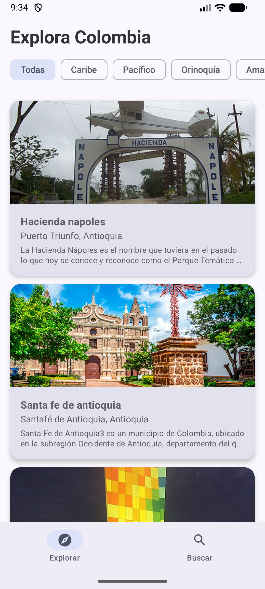 | 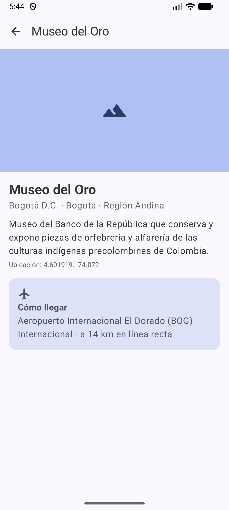 | 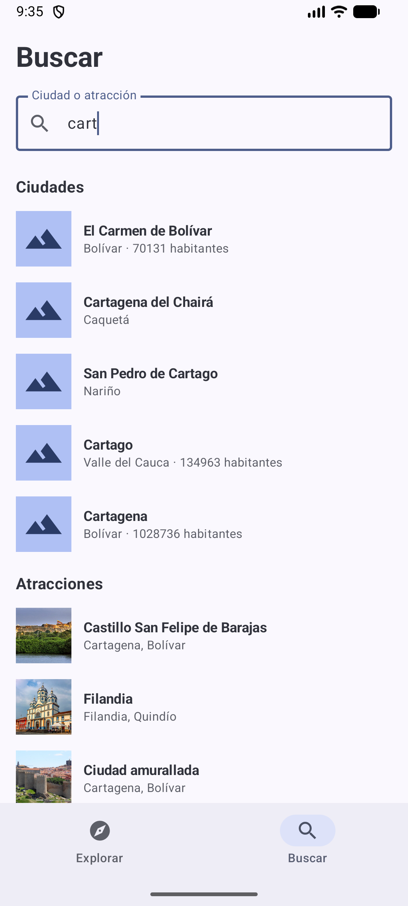 | 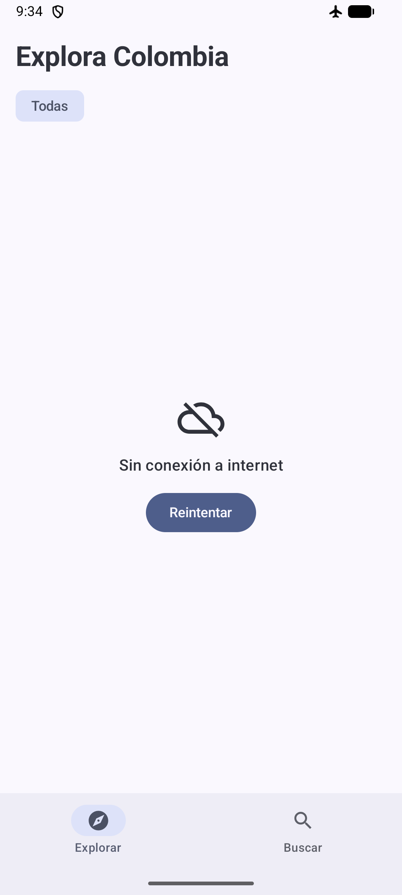 |

### Lo que falta (siguiente fase)

- **Room:** las atracciones guardadas hoy viven en memoria; con Room quedarán guardadas en el celular y se podrán ver sin internet (Sesión 5).
- **Hilt:** inyectar el Repositorio en los ViewModels (Sesión 6). Desde la [sección 11](#11-capa-de-repositorio) ya no es un `object`: es una interfaz con su implementación.
- **Navegación:** pasar de la navegación con estado a Navigation Compose (Sesión 8). ✅ Hecho en la [sección 10](#10-fase-4-navegación-type-safe).

---

## 10. Fase 4: navegación type-safe

Seguimos el *Tutorial: Navegación Segura (Type-Safe) en Android con Jetpack Compose* de la documentación del curso. Antes la app cambiaba de pantalla con una variable de estado en `MainActivity`; ahora usa **Navigation Compose** con rutas tipadas.

| Paso de la guía | Cómo quedó en Rumbo Colombia |
|---|---|
| **Dependencias** | En `libs.versions.toml`: `navigation-compose` 2.8.8, `kotlinx-serialization-json` 1.8.0 y el plugin `kotlin-serialization`. En `app/build.gradle.kts` se aplica el plugin y se agregan las dos librerías. |
| **Rutas (`Destinations.kt`)** | `object ExplorarScreen` (sin parámetros), `data class DetalleScreen(val attractionId: Int)` (lleva el id de la atracción) y `object BuscarScreen`. Todas con `@Serializable`, así no se usan textos como `"detalle/123"`. |
| **Pantallas con callbacks** | Las pantallas no reciben el `NavController`: reciben eventos. `ExplorarScreen` tiene `onNavigateToDetalle` y `onNavigateToBuscar` (botón **Ir a Buscar**); `DetalleScreen` y `BuscarScreen` tienen `onBack` (flecha ←). |
| **Grafo (`AppNavigation.kt`)** | `rememberNavController()` y un `NavHost` que empieza en `ExplorarScreen`. Cada ruta se registra con `composable<...>`; el Detalle recupera el id con `backStackEntry.toRoute()` y para volver se usa `navController.popBackStack()`. |
| **`MainActivity.kt`** | Solo llama a `AppNavigation()` dentro del tema. |

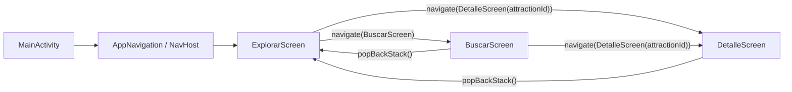

### La app con la navegación nueva (build OK)

| Explorar | Detalle | Buscar |
|---|---|---|
| 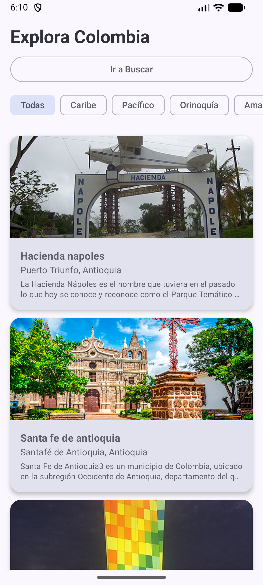 | 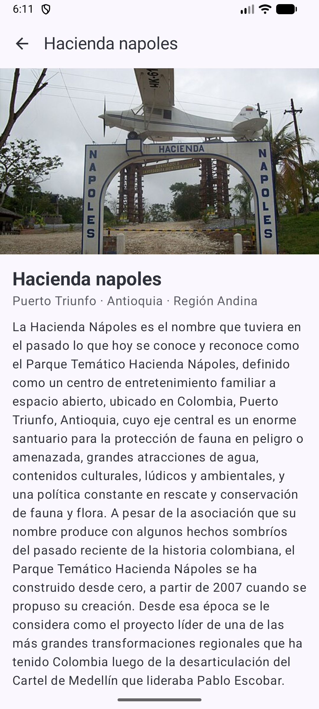 | 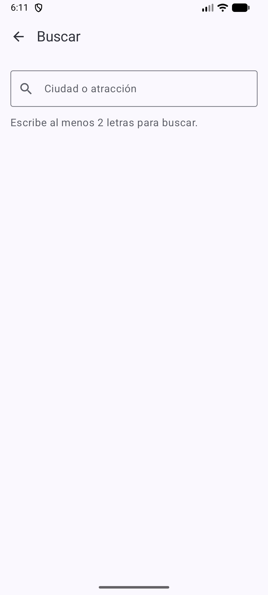 |

### Nueva vista: Perfil de Usuario

Seguimos la *Guía Paso a Paso: Cómo Agregar una Nueva Vista a la Navegación* de la documentación del curso, con sus 4 pasos:

| Paso de la guía | Qué se hizo |
|---|---|
| **1. Definir la ruta** | En `Destinations.kt`: `@Serializable data class ProfileScreen(val username: String)`. |
| **2. Crear la pantalla** | `presentation/screens/ProfileScreen.kt`: barra superior *Perfil de Usuario* con ←, el texto *👤 Usuario: …* y el botón **Regresar**. |
| **3. Registrar la ruta** | En el `NavHost` de `AppNavigation.kt`: `composable<ProfileScreen>`, que recupera el `username` con `toRoute()` y vuelve con `popBackStack()`. |
| **4. Disparar la navegación** | `ExplorarScreen` recibe el callback `onNavigateToProfile` y tiene el botón **Ver Perfil**, que navega con `navController.navigate(ProfileScreen(username = "usuario_demo"))`. |

**Verificación:** se ejecutó la app, se tocó **Ver Perfil**, la pantalla mostró el usuario recibido y **Regresar** volvió a Explorar.

| Explorar con "Ver Perfil" | Perfil de Usuario |
|---|---|
| 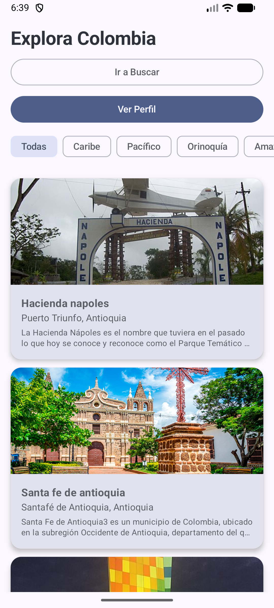 | 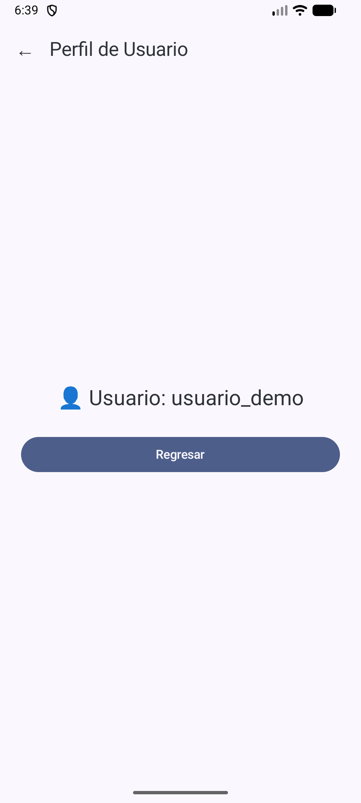 |

---

## 11. Capa de Repositorio

Seguimos el *Tutorial Paso a Paso: La Capa de Repositorio en Android con Kotlin* de la documentación del curso. Antes el repositorio era un `object` que los ViewModels usaban directamente; ahora tiene una **interfaz** (el contrato) y una **implementación concreta**.

| Lo que pide la guía | Cómo quedó en Rumbo Colombia |
|---|---|
| **Interfaz del repositorio** | `interface TurismoRepository` en `data/repository/`, con funciones `suspend` que devuelven `Result<T>`: `obtenerRegiones()`, `obtenerAtracciones()`, `obtenerDetalle(id)`, `buscar(texto)` y `departamentoDe(ciudad)`. |
| **Implementación concreta** | `class TurismoRepositoryImpl(private val api: ApiColombiaService = RetrofitClient.api) : TurismoRepository`. La API entra por el constructor con un valor por defecto. |
| **`runCatching`** | Cada función envuelve la petición en `runCatching { ... }`: si sale bien devuelve `Result.success`, y si falla (sin internet, error 404/500) devuelve `Result.failure` sin que la app se cierre. |
| **Consumo desde el ViewModel** | `ExplorarViewModel`, `DetalleViewModel` y `BuscarViewModel` reciben el repositorio en el constructor (`repositorio: TurismoRepository = TurismoRepositoryImpl()`) y usan `viewModelScope.launch` con `.onSuccess { }` y `.onFailure { }`. |

Como cada pantalla crea su propio `TurismoRepositoryImpl`, lo que deben compartir (las atracciones guardadas y los datos que no cambian) quedó en el `companion object` de la clase.

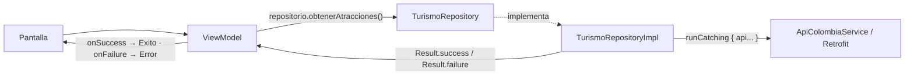

**Verificación (build OK):** en el emulador cargaron Explorar, el Detalle, el botón **Guardar sin internet** (la marca aparece al volver a Explorar) y Buscar con *Medellín*. Sin internet, `onFailure` muestra *Sin conexión a internet* con **Reintentar**.

---

## 12. Capa de Red (Network Layer)

Seguimos el *Tutorial Paso a Paso: Cómo Crear la Capa de Red (Network Layer) y Consumir APIs en Android* de la documentación del curso. Antes Retrofit usaba **Gson**; ahora usa **Kotlinx Serialization** y **OkHttp** con registro de las peticiones.

| Lista de comprobación de la guía | Cómo quedó en Rumbo Colombia |
|---|---|
| **Permiso `INTERNET`** | Ya estaba en `AndroidManifest.xml` desde la Fase 3. |
| **Dependencias** | En `libs.versions.toml`: `retrofit-core` y `retrofit-kotlinx-serialization` (2.11.0) y `okhttp-logging` (4.12.0). Se quitó `converter-gson`. En `app/build.gradle.kts`: `libs.retrofit.core`, `libs.retrofit.kotlinx.serialization` y `libs.okhttp.logging`. |
| **DTO con `@Serializable`** | `Region`, `Department`, `City`, `TouristicAttraction` y `Airport` en `data/dto/Modelos.kt`. |
| **`ApiClient.kt` (singleton)** | Nuevo `object ApiClient` en `data/api/`: `BASE_URL` que termina en `/`, `Json { ignoreUnknownKeys, coerceInputValues, isLenient, explicitNulls = false, encodeDefaults = false }`, `HttpLoggingInterceptor` con nivel `BODY`, `OkHttpClient`, `retrofit by lazy` y `apiColombiaService by lazy`. |
| **Funciones `suspend` y rutas** | `ApiColombiaService` ya tenía sus 7 endpoints `suspend` con las rutas de API Colombia (`Region`, `TouristicAttraction`, `City/search/{keyword}`, …). |
| **Consumo desde el Repositorio** | `TurismoRepositoryImpl(private val api: ApiColombiaService = ApiClient.apiColombiaService)`. `data/network/RetrofitClient.kt` se deja como acceso por el paquete `data.network` (`val api get() = ApiClient.apiColombiaService`), igual que en la referencia del proyecto. |

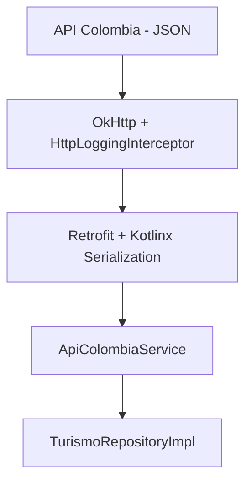

**Verificación (build OK):** en el Logcat aparecen las peticiones (`--> GET https://api-colombia.com/api/v1/Region` y `<-- 200 OK`). En el emulador cargaron Explorar, el Detalle con la ubicación y el aeropuerto más cercano, y Buscar con *Cartagena*. Las coordenadas que la API manda como texto se convierten bien a número.

---

## 13. Estructura según la Referencia de Avance

Comparamos el proyecto con las páginas *Referencia de Avance 1* y *Referencia de Avance 2* del Proyecto Integrador en la documentación del curso, y ajustamos la estructura de carpetas:

| Lo que muestra la referencia | Cómo quedó en Rumbo Colombia |
|---|---|
| **`presentation/navigation/`** con `Destinations.kt` y `AppNavigation.kt` | Los dos archivos pasaron de `presentation/screens/` a `presentation/navigation/`. `MainActivity` importa `AppNavigation` desde ahí. |
| **`presentation/components/`** con un archivo por componente | `Componentes.kt` se separó en `TarjetaAtraccion.kt`, `FilaResultado.kt`, `FotoAtraccion.kt`, `Cargando.kt` y `ErrorConReintentar.kt`. |
| **`docs/tutorial_arquitectura.md`** (paquete de documentación) | Nuevo [`docs/tutorial_arquitectura.md`](app/src/main/java/com/rumbocolombia/android/docs/tutorial_arquitectura.md): estructura completa, diagrama de cómo se conectan los archivos y el flujo de ver el detalle de una atracción paso a paso. |
| **Capas de datos** (`api`, `network`, `dto`, `repository`) | Ya quedaron así con las secciones [11](#11-capa-de-repositorio) y [12](#12-capa-de-red-network-layer). |

**Verificación (build OK):** en el emulador se probaron Explorar, el Detalle y la vista Perfil; la navegación funciona igual que antes.

---

## 14. Capa de Datos local con Room

En la sustentación del Avance 1 el criterio **Capa de Acceso a Datos** pedía que esa capa también guarde datos en el celular (persistencia local con SQLite o Room). La agregamos con **Room 2.8.4** (con KSP para generar el código).

**Qué guarda:**

| Tabla | Clase | Para qué sirve |
|---|---|---|
| `atracciones` | `AtraccionEntity` | Copia de cada atracción que llega de la API, con su ciudad, departamento y región. |
| `guardadas` | `GuardadaEntity` | Ids de las atracciones que el usuario guarda con el botón **Guardar**. Antes estaban solo en memoria y se borraban al cerrar la app. |

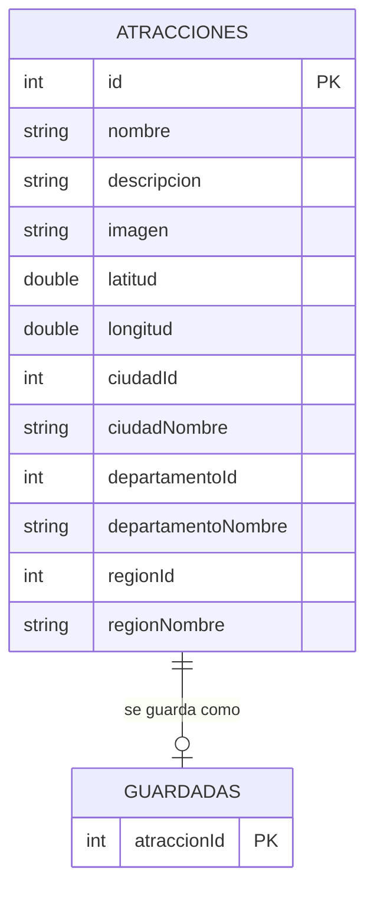

**Archivos nuevos** (paquete `data/local/`):

| Archivo | Qué hace |
|---|---|
| `AtraccionEntity.kt` y `GuardadaEntity.kt` | Las 2 tablas (`@Entity`). |
| `AtraccionDao.kt` | Las consultas SQL (`@Dao`): guardar, listar, buscar por nombre o ciudad, y observar las guardadas con `Flow`. |
| `BaseDeDatos.kt` | La base de datos `rumbo_colombia.db` (`@Database`), una sola para toda la app (Singleton). |
| `Mapeo.kt` | Convierte el DTO de la API en fila de la tabla y al revés. |
| `RumboColombiaApp.kt` | Clase `Application` que crea la base de datos al abrir la app (registrada en el `AndroidManifest`). |

**Cómo funciona el repositorio ahora:** `TurismoRepositoryImpl` tiene 2 fuentes, la API (Retrofit) y Room (`AtraccionDao`). Primero pide a la API y guarda la respuesta en Room. Si no hay internet, responde con lo que quedó en el celular. Si tampoco hay nada guardado, devuelve el error y la pantalla muestra **Reintentar**. Los ViewModels y las pantallas no cambiaron: siguen pidiendo los datos al repositorio sin saber de dónde salen.

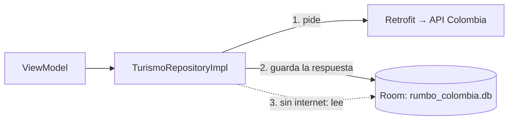

**Verificación (build OK):** en el emulador se abrió la app con internet, se guardó Hacienda Nápoles y se reinició la app. Luego se apagaron el Wi‑Fi y los datos: Explorar mostró la lista y los filtros por región desde Room, y el Detalle abrió sin internet (sin el aeropuerto, que viene de la API).

---

## 15. Justificación tecnológica

Por qué escogimos cada herramienta y qué papel cumple en la arquitectura:

| Tecnología | Capa | Por qué la usamos |
|---|---|---|
| **Kotlin** | Todas | Es el lenguaje oficial de Android. Su manejo de nulos (`?`) evita cierres por datos vacíos de la API. |
| **Jetpack Compose + Material 3** | Presentación | Las pantallas se escriben con menos código y se redibujan solas cuando cambia el estado. |
| **MVVM** | Presentación y lógica | Separa la pantalla (solo muestra), el ViewModel (estado y lógica) y el repositorio (datos). Cada parte se puede cambiar sin tocar las otras. |
| **ViewModel + StateFlow + `UiState`** | Lógica | El estado sobrevive a la rotación y cada pantalla tiene sus 3 estados: Cargando, Éxito y Error. |
| **Corrutinas (`suspend`, `Dispatchers.IO`)** | Lógica y datos | Las peticiones y la base de datos corren en segundo plano, así la app no se congela. |
| **Repositorio (interfaz + `Impl`) con `Result`** | Datos | Los ViewModels no saben si los datos vienen de la API o de Room. Un error se devuelve como `Result.failure` y la app no se cierra. |
| **Retrofit 2.11.0 + Kotlinx Serialization** | Datos (red) | Retrofit declara los endpoints como funciones y Kotlinx convierte el JSON en clases de Kotlin, sin reflexión. |
| **OkHttp Logging Interceptor** | Datos (red) | Muestra en el Logcat cada petición y respuesta, para depurar. |
| **Room 2.8.4** | Datos (local) | Guarda las atracciones en el celular: la app funciona sin señal, que es la promesa de Rumbo Colombia. |
| **Coil** | Presentación | Carga las fotos desde la URL y las guarda en caché. |
| **Navigation Compose type-safe** | Presentación | Las rutas son clases `@Serializable`: si un dato entre pantallas está mal, falla al compilar y no con la app abierta. |
| **API Colombia** | Fuente externa | Datos reales de Colombia, en español, gratis y sin API key. |
| **GitHub Flow** | Equipo | Una rama y un Pull Request por cambio, revisado por el compañero antes de unir a `main`. |

---

## 16. Conclusiones y aprendizajes

**Retos que resolvimos:**

| Reto | Cómo lo resolvimos |
|---|---|
| En `/Airport` la API trae la latitud y la longitud al revés, y el aeropuerto más cercano salía mal. | Lo detectamos comparando con El Dorado y el repositorio las invierte antes de calcular la distancia (fórmula de Haversine). |
| La búsqueda de la API no trae la ciudad de cada atracción. | El repositorio la toma de la lista completa de atracciones. |
| El PR del Hito 2 se abrió sobre la rama del Hito 1 y no llegó a `main`. | Lo corregimos con el PR #3 y desde entonces cada rama sale de `main` actualizado. |
| Sin internet la app solo mostraba un error. | Agregamos Room (sección 14): ahora muestra lo que ya se había cargado. |

**Aprendizajes:**

- Organizar una app por capas (presentación, lógica y datos) hace que cada archivo tenga una sola responsabilidad.
- Consumir una API real enseña a desconfiar de los datos: campos vacíos, tipos distintos y coordenadas al revés.
- Trabajar con ramas y Pull Requests deja un historial claro de quién hizo qué y cuándo.

**Conclusión:** gracias a la arquitectura por capas pudimos agregar Room sin cambiar ninguna pantalla: solo cambió el repositorio. Rumbo Colombia cumple su idea principal, ser una guía turística que funciona incluso sin señal.
