# 🧭 Rumbo Colombia

**Tu guía para recorrer Colombia, incluso sin señal.**

Diseño y arquitectura de una aplicación móvil Android que muestra los atractivos turísticos de Colombia organizados por región, departamento y ciudad, consumiendo la API pública [API Colombia](https://api-colombia.com).

> Proyecto Integrador · Aplicaciones Móviles Android · SENA, Tecnología en Análisis y Desarrollo de Software · Ficha 3229209 · Grupo 2
>
> Este repositorio contiene **solo el diseño** de la app y el **proyecto base** generado por Android Studio. Todavía no tiene código de la aplicación: todo lo que se planificó está documentado en este README.

## Integrantes

| Integrante | Rol en el equipo |
|---|---|
| Manuela Córdoba Robledo | Líder del equipo |
| Davier Andrés Quinto Bejarano | Integrante |

## Contenido

1. [Idea y API elegida](#1-idea-y-api-elegida) (Hito 1)
2. [Modelo de datos](#2-modelo-de-datos) (Hito 2)
3. [Pantallas y flujo de navegación](#3-pantallas-y-flujo-de-navegación) (Hito 3)
4. [Arquitectura y endpoints](#4-arquitectura-y-endpoints) (Hito 4)
5. [Proyecto base en Android Studio](#5-proyecto-base-en-android-studio) (Hito 5)
6. [Video de presentación](#6-video-de-presentación) (Hito 6)
7. [Cómo trabajamos (GitHub Flow)](#7-cómo-trabajamos-github-flow) (Hito 7)
8. [Fase 2: vistas y modelo en código](#8-fase-2-vistas-y-modelo-en-código)

---

## 1. Idea y API elegida

### Elevator pitch

**Rumbo Colombia** es una guía turística para el celular que ayuda a viajeros nacionales y extranjeros a descubrir los atractivos turísticos de Colombia, organizados por **región, departamento y ciudad**.

**El problema:** la información turística está repartida en muchas páginas, y en las carreteras y los pueblos casi nunca hay buena señal. El viajero termina sin saber qué visitar ni cómo llegar.

**La solución:** una app que muestra cada atracción con fotos, descripción y ubicación en el mapa, indica el **aeropuerto más cercano** para planear la llegada y **guarda la información en el celular** para consultarla sin internet.

### ¿Por qué una app móvil y no una página web?

1. **El viajero está en movimiento.** El celular es lo único que lleva siempre consigo durante el viaje.
2. **Ubicación y mapas.** Cada atracción tiene latitud y longitud, así que la app puede abrirla en el mapa del celular y calcular qué tan cerca queda.
3. **Sin señal no hay web.** En zonas rurales la conexión falla; la app guarda la región que el usuario va a visitar para consultarla offline.
4. **Avisos.** Una app puede recordarle al viajero los lugares que guardó, algo que una página web no hace bien.

### API elegida: API Colombia

| | |
|---|---|
| **Nombre** | API Colombia |
| **URL base** | `https://api-colombia.com/api/v1/` |
| **Documentación** | [api-colombia.com/swagger](https://api-colombia.com/swagger) |
| **Autenticación** | No necesita API key: es pública y gratuita |
| **Formato** | JSON, con los textos en español |

**Por qué la elegimos:** tiene datos reales de Colombia, en español y sin costo, y sus recursos están relacionados entre sí (una región tiene departamentos, un departamento tiene ciudades y una ciudad tiene atracciones y aeropuertos). Eso nos permite diseñar un modelo de datos completo y una navegación natural de lo general a lo particular.

### Recursos de la API que usará la app

| Recurso | Endpoint base | Cantidad aprox. | Para qué lo usa la app |
|---|---|---|---|
| **Región** | `/Region` | 6 | Explorar el país por regiones (Caribe, Pacífico, Andina…) |
| **Departamento** | `/Department` | 33 | Agrupar las ciudades de cada región |
| **Ciudad** | `/City` | 1.123 | Ubicar cada atracción y buscar destinos por nombre |
| **Atracción turística** | `/TouristicAttraction` | 41 | Lista principal y detalle: fotos, descripción y coordenadas |
| **Aeropuerto** | `/Airport` | 52 | Mostrar el aeropuerto más cercano para llegar al destino |

*Cantidades consultadas en la API el 19 de octubre de 2026.*

---

## 2. Modelo de datos

Diagrama entidad-relación de los 5 recursos que llegan de API Colombia, con los atributos que usará la app. Los nombres de las entidades y los campos son los mismos del JSON de la API, para que el mapeo a las clases de Kotlin sea directo.

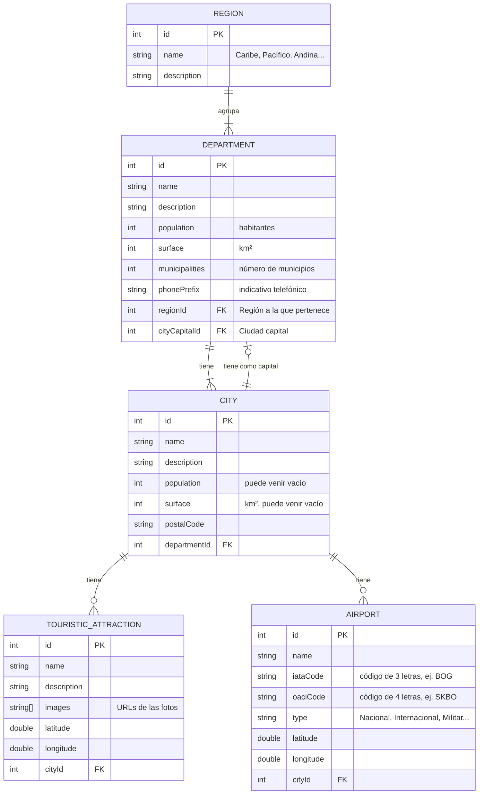

### Relaciones

| Relación | Tipo | Cómo se lee |
|---|---|---|
| Región → Departamento | **1 : N** | Una región agrupa uno o varios departamentos; cada departamento pertenece a una sola región (`regionId`). |
| Departamento → Ciudad | **1 : N** | Un departamento tiene una o varias ciudades; cada ciudad pertenece a un solo departamento (`departmentId`). |
| Departamento → Ciudad capital | **1 : 1** | Cada departamento tiene exactamente una ciudad capital (`cityCapitalId`); una ciudad es capital de máximo un departamento. |
| Ciudad → Atracción turística | **1 : N** | Una ciudad puede tener cero o varias atracciones; cada atracción queda en una sola ciudad (`cityId`). |
| Ciudad → Aeropuerto | **1 : N** | Una ciudad puede tener cero o varios aeropuertos; cada aeropuerto queda en una sola ciudad (`cityId`). |

### Decisiones del modelo

- **Solo los campos que la app necesita.** La API trae más información (presidentes, emisoras, reservas indígenas…), pero se dejó por fuera porque ninguna pantalla la usa.
- **Coordenadas como `double`.** Atracciones y aeropuertos traen `latitude` y `longitude`; con ellas la app abre el mapa y calcula cuál es el aeropuerto más cercano a cada atracción.
- **Campos que pueden venir vacíos.** La mayoría de las ciudades (1.060 de 1.123) no traen `population` ni `surface`; en Kotlin se modelarán como tipos *nullable* (`Int?`) y la pantalla solo los mostrará cuando existan, para que la app no falle.
- **Un detalle de la API:** en el JSON de aeropuertos el campo del departamento se llama `deparmentId` (sin la "t"). La app usará el `cityId`, que es el dato confiable, y llega al departamento a través de la ciudad.

---

## 3. Pantallas y flujo de navegación

Las pantallas se diseñaron en **Google Stitch** como un prototipo interactivo: se puede tocar una tarjeta para abrir el detalle, usar la barra inferior para cambiar de pantalla y volver atrás.

🔗 **Prototipo en Google Stitch:** [stitch.withgoogle.com/projects/10235196442344271062](https://stitch.withgoogle.com/projects/10235196442344271062)

**Sistema de diseño:** Material Design 3 con los colores de la bandera de Colombia usados como paleta: azul profundo como color principal, amarillo como acento y rojo para estados importantes, sobre fondo claro.

### Flujo de navegación

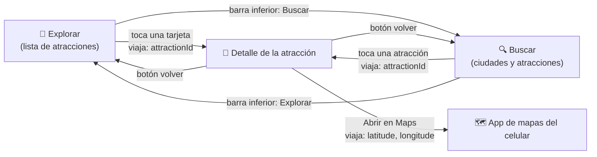

El único dato que viaja entre pantallas es el **`attractionId`**: la pantalla de detalle lo recibe y con él pide la información completa a la API. Así cada pantalla es independiente y el detalle se puede abrir desde Explorar o desde Buscar.

### Pantalla 1 · Explorar (lista principal)

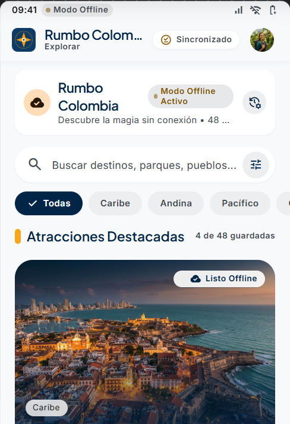

| | |
|---|---|
| **Qué muestra** | Las atracciones turísticas en tarjetas con foto, nombre, ciudad y departamento. Arriba, una barra de búsqueda rápida y chips para filtrar por región. Cada tarjeta indica si ya está guardada para ver sin internet. |
| **De dónde salen los datos** | `GET /TouristicAttraction` (lista con la ciudad de cada atracción). `GET /Department` y `GET /Region` para mostrar el departamento y filtrar por región. |
| **Acciones del usuario** | Tocar una tarjeta → abre el **Detalle**. Tocar un chip de región → filtra la lista. Tocar el ícono de guardar → la guarda en el celular. Barra inferior → cambia a **Buscar**. |
| **Datos que envía** | `attractionId` al Detalle. |

### Pantalla 2 · Detalle de la atracción

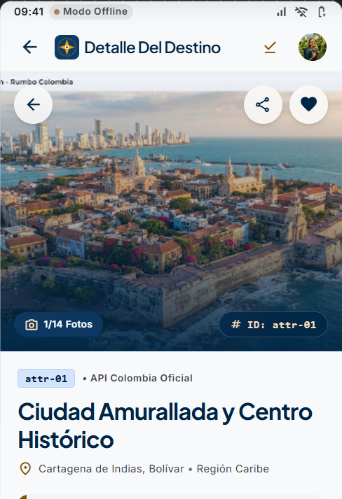 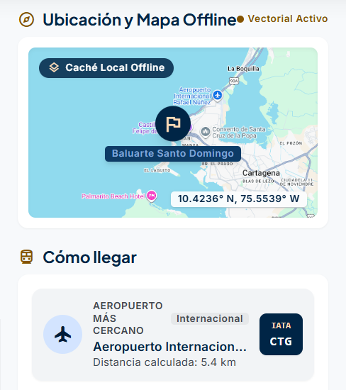

| | |
|---|---|
| **Qué muestra** | Foto grande, nombre, ciudad, departamento y región, descripción completa, un mapa con la ubicación y la tarjeta **"Cómo llegar"** con el aeropuerto más cercano (nombre, código IATA, tipo y distancia en km). |
| **De dónde salen los datos** | `GET /TouristicAttraction/{id}` (detalle con fotos y coordenadas). `GET /Airport` para calcular el aeropuerto más cercano a partir de la latitud y longitud de la atracción y de cada aeropuerto. |
| **Acciones del usuario** | Volver → regresa a la pantalla anterior. **Abrir en Maps** → abre la app de mapas del celular con las coordenadas. **Guardar sin internet** → guarda la atracción en el celular. Compartir. |
| **Datos que recibe** | `attractionId`. |

### Pantalla 3 · Buscar

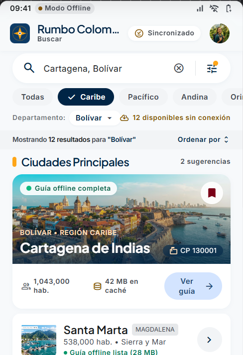

| | |
|---|---|
| **Qué muestra** | Un campo de búsqueda grande, filtros por región y departamento, y los resultados separados en **ciudades** (con departamento, población cuando existe y código postal) y **atracciones** (con foto pequeña). |
| **De dónde salen los datos** | `GET /City/search/{texto}` y `GET /TouristicAttraction/search/{texto}`. Para el filtro por departamento: `GET /Region/{id}/departments`. |
| **Acciones del usuario** | Escribir → busca ciudades y atracciones. Elegir región o departamento → filtra. Tocar una atracción → abre el **Detalle**. Barra inferior → vuelve a **Explorar**. |
| **Datos que envía** | `attractionId` al Detalle. |

### Notas del prototipo

- **Todo lo que muestran las pantallas sale de API Colombia**, menos lo que calcula la app (la distancia al aeropuerto y el espacio que ocupa lo guardado en el celular). Al diseñar se quitaron a propósito las estrellas, reseñas, precios y audioguías que Stitch proponía, porque la API no tiene esos datos.
- Algunos textos de apoyo del prototipo, como las indicaciones de transporte terrestre en "Cómo llegar" o etiquetas como "Mejor temporada", son de ejemplo visual. En la app se reemplazarán por datos de la API o no se mostrarán.
- La tercera opción de la barra inferior, **Guardados**, queda planeada para una siguiente versión: mostraría las atracciones guardadas para ver sin internet.

---

## 4. Arquitectura y endpoints

La app se va a organizar con el patrón **MVVM**: cada pantalla solo dibuja lo que le da su ViewModel, el ViewModel le pide los datos al repositorio y el repositorio decide si los trae de internet (API Colombia) o del celular (lo guardado para ver sin señal).

### Diagrama de arquitectura

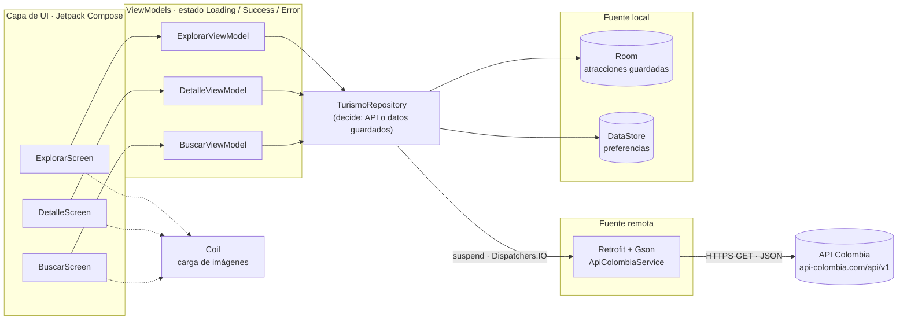

### Cómo funciona cada capa

| Capa | Qué hace | Tecnología |
|---|---|---|
| **UI** | Dibuja las 3 pantallas y le avisa al ViewModel lo que hace el usuario (tocar una tarjeta, escribir en el buscador). No sabe de dónde vienen los datos. | Jetpack Compose, Material 3, Navigation Compose |
| **ViewModel** | Guarda el estado de cada pantalla y sobrevive cuando se gira el celular. Lanza las consultas en una corrutina. | ViewModel + `StateFlow` |
| **Repositorio** | Es el único que habla con las fuentes de datos. Si hay internet consulta la API; si no, devuelve lo guardado en Room. | Kotlin Coroutines (`suspend`, `Dispatchers.IO`) |
| **Fuente remota** | Hace las peticiones HTTP a API Colombia y convierte el JSON en objetos de Kotlin. | Retrofit + Gson |
| **Fuente local** | Guarda las atracciones que el usuario marca para ver sin señal, y preferencias como la última región elegida. | Room y DataStore |
| **Imágenes** | Descarga las fotos de las atracciones y las guarda en caché. | Coil |

### Estados de cada pantalla

Cada ViewModel expone uno de estos tres estados y la pantalla se dibuja según cuál sea:

| Estado | Qué ve el usuario |
|---|---|
| **Loading** | Un indicador de carga mientras llega la respuesta. |
| **Success** | La lista, el detalle o los resultados de la búsqueda. |
| **Error** | Un mensaje claro (por ejemplo "Sin conexión") con un botón **Reintentar**. Si la atracción está guardada en el celular, se muestra igual desde Room. |

### Seguridad

- **API Colombia no necesita API Key**: es pública y solo de lectura, así que no hay ninguna clave que proteger.
- Si en una versión futura se usa un servicio con clave (por ejemplo un mapa), la clave irá en `local.properties`, que ya está en el `.gitignore`, y se leerá con `BuildConfig`. **Nunca se sube al repositorio.**
- Todas las peticiones van por **HTTPS**.

### Endpoints que consumirá la app

URL base: `https://api-colombia.com/api/v1/`

| Endpoint | Método HTTP | Parámetros | Propósito en la app |
|---|---|---|---|
| `/TouristicAttraction` | GET | — | Lista de atracciones para la pantalla **Explorar**. |
| `/TouristicAttraction/{id}` | GET | `id` (path): id de la atracción | Información completa, fotos y coordenadas para la pantalla **Detalle**. |
| `/TouristicAttraction/search/{keyword}` | GET | `keyword` (path): texto que escribe el usuario | Atracciones que coinciden con la búsqueda en **Buscar**. |
| `/City/search/{keyword}` | GET | `keyword` (path): texto que escribe el usuario | Ciudades que coinciden con la búsqueda en **Buscar**. |
| `/Region` | GET | — | Las 6 regiones para los chips de filtro en **Explorar** y **Buscar**. |
| `/Region/{id}/departments` | GET | `id` (path): id de la región | Departamentos de una región para el filtro de **Buscar**. |
| `/Department` | GET | — | Nombre del departamento de cada atracción en las tarjetas de **Explorar**. |
| `/Airport` | GET | — | Aeropuertos con sus coordenadas para calcular el más cercano en **Detalle** ("Cómo llegar"). |

> Todos los endpoints se probaron el 20 de octubre de 2026 y responden `200 OK` con JSON.

### Estructura de carpetas planeada

Esto es solo el plan: **todavía no existe en el proyecto**, porque la actividad pide dejar el proyecto base sin código.

```
com.rumbocolombia.android
├── data
│   ├── remote      → ApiColombiaService (Retrofit) y los DTO del JSON
│   ├── local       → Room (atracciones guardadas) y DataStore
│   └── repository  → TurismoRepository
├── ui
│   ├── explorar    → ExplorarScreen + ExplorarViewModel
│   ├── detalle     → DetalleScreen + DetalleViewModel
│   ├── buscar      → BuscarScreen + BuscarViewModel
│   └── theme       → colores y tipografía
└── MainActivity.kt
```


---

## 5. Proyecto base en Android Studio

El proyecto se creó en Android Studio con la plantilla **Empty Activity** y se subió **tal como lo generó el asistente**, sin agregar ni quitar nada. Todo el diseño de la app vive en este README; el código empezará en la siguiente etapa del proyecto.

| Dato | Valor |
|---|---|
| Plantilla | Empty Activity |
| Lenguaje | Kotlin |
| Interfaz | Jetpack Compose (Material 3) |
| Configuración de Gradle | Kotlin DSL (`build.gradle.kts`) |
| Paquete | `com.rumbocolombia.android` |
| SDK mínimo | API 24 (Android 7.0) |
| Commit inicial | [`d8bee3d`](https://github.com/robledocordoba123-cmyk/android-design-rumbocolombia/commit/d8bee3ddcdefd81416af99555b9ba5d766210cd9) · 19 de octubre de 2026 |

### La app corriendo en el emulador

El proyecto base compila y se ejecuta sin errores en el emulador de Android Studio (Medium Phone). Muestra el texto de ejemplo que trae la plantilla:

<p align="center">
  
</p>

### Qué trae el proyecto (y qué no)

- `MainActivity.kt` con el `Greeting("Android")` de la plantilla.
- `ui/theme/` con `Color.kt`, `Theme.kt` y `Type.kt` generados por Android Studio.
- Las pruebas de ejemplo (`ExampleUnitTest` y `ExampleInstrumentedTest`).
- **No** hay data classes, ViewModels, llamadas a la API ni pantallas propias. Desde el commit inicial, los únicos archivos que cambiaron son este README y las imágenes de la carpeta `docs/`.

---

## 6. Video de presentación

Video de máximo 5 minutos donde los dos integrantes explican la idea y la API, el modelo de datos, las pantallas de Stitch, la arquitectura MVVM y muestran el proyecto base corriendo.

🎬 **Ver el video:** *pendiente: se agrega el enlace cuando esté grabado*

El guion, con lo que dice cada integrante y el tiempo de cada parte, está en [docs/GUION_VIDEO.md](docs/GUION_VIDEO.md).

---

## 7. Cómo trabajamos (GitHub Flow)

Usamos **GitHub Flow**: `main` siempre tiene la versión revisada, y cada hito se trabaja en su propia rama y entra a `main` solo por medio de un Pull Request aprobado.

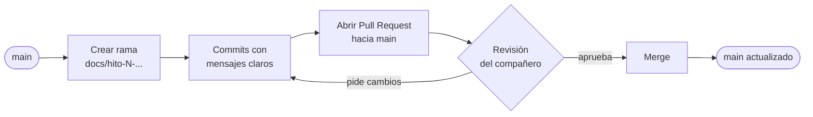

### Reglas que seguimos

- **Nadie trabaja directo en `main`.** El único commit en `main` sin Pull Request es el del proyecto base generado por Android Studio.
- **Una rama por hito**, con el nombre `docs/hito-N-tema` (por ejemplo `docs/hito-2-modelo-datos`).
- **Mensajes de commit en español** que empiezan por el hito y dicen qué se hizo: `Hito 4: arquitectura MVVM en Mermaid y tabla de endpoints`.
- **Cada Pull Request lo revisa el otro integrante**, que lo aprueba antes de hacer el merge.

### Historial de Pull Requests

| PR | Rama | Qué agregó | Revisión |
|---|---|---|---|
| [#1](https://github.com/robledocordoba123-cmyk/android-design-rumbocolombia/pull/1) | `docs/hito-1-idea-y-api` | Hito 1: idea, elevator pitch y API elegida | Aprobado por Davier |
| [#2](https://github.com/robledocordoba123-cmyk/android-design-rumbocolombia/pull/2) | `docs/hito-2-modelo-datos` | Hito 2: diagrama ER (se unió por error a la rama del Hito 1) | Aprobado por Davier |
| [#3](https://github.com/robledocordoba123-cmyk/android-design-rumbocolombia/pull/3) | `docs/hito-2-modelo-datos` | Hito 2 llevado a `main` para corregir lo anterior | Aprobado por Davier |
| [#4](https://github.com/robledocordoba123-cmyk/android-design-rumbocolombia/pull/4) | `docs/hito-3-pantallas` | Hito 3: pantallas en Google Stitch y flujo de navegación | Aprobado por Davier |
| [#5](https://github.com/robledocordoba123-cmyk/android-design-rumbocolombia/pull/5) | `docs/hito-4-arquitectura` | Hito 4: arquitectura MVVM y tabla de endpoints | Aprobado por Davier |
| — | `docs/hito-5-proyecto-base` | Hito 5: proyecto base con captura | — |
| — | `docs/hito-6-video` | Hito 6: guion y sección del video | — |
| — | `docs/hito-7-github-flow` | Hito 7: esta sección | — |

### Lo que aprendimos

Al principio abrimos el PR del Hito 2 **sobre la rama del Hito 1** en lugar de `main`. Cuando se unió el Hito 1, el Hito 2 terminó en una rama que ya no se usaba y no llegó a `main`. Lo corregimos con el PR #3, y desde entonces **cada rama nueva sale de `main` actualizado** y cada Pull Request apunta a `main`.

---

## 8. Fase 2: vistas y modelo en código

En la clase del 27 de octubre el instructor pidió avanzar el proyecto con la documentación de la Sesión 4 (MVVM): **modelo de datos, ViewModel y vistas**, y que el proyecto compile. Seguimos la "receta de 4 pasos" de la guía (modelo → ViewModel → pantalla → probar en `MainActivity`) y la estructura de carpetas del tema *ViewModel y capas de la app*.

```
com.rumbocolombia.android/
├── data/
│   ├── dto/            Modelos.kt (las 5 data class)
│   └── repository/     RumboRepository.kt, DatosDeEjemplo.kt
├── presentation/
│   ├── viewmodel/      RumboViewModel.kt
│   ├── screens/        ExplorarScreen.kt, DetalleScreen.kt, BuscarScreen.kt
│   └── components/     Componentes.kt (tarjeta, fila y foto reutilizables)
├── ui/theme/           (viene por defecto)
└── MainActivity.kt
```

| Capa | Archivo | Qué hace |
|---|---|---|
| **Modelo** | `data/dto/Modelos.kt` | Las 5 data class del diagrama ER: `Region`, `Department`, `City`, `TouristicAttraction` y `Airport`, con los mismos campos de la API. `population` y `surface` de la ciudad son `Int?` porque pueden venir vacíos. |
| **Repositorio** | `data/repository/RumboRepository.kt` | Le entrega los datos al ViewModel. Por ahora los toma de `DatosDeEjemplo.kt` (2 regiones, 5 departamentos, 6 ciudades, 7 atracciones y 6 aeropuertos copiados de API Colombia); en la sesión de Retrofit solo cambia esta clase. |
| **ViewModel** | `presentation/viewmodel/RumboViewModel.kt` | Guarda el estado con `MutableStateFlow` privado y `StateFlow` público: filtro por región, texto de búsqueda y resultados. Calcula el aeropuerto más cercano con la fórmula de Haversine. |
| **Vistas** | `presentation/screens/` y `presentation/components/` | Las 3 pantallas diseñadas en Stitch, hechas en Jetpack Compose. Observan el ViewModel con `collectAsState()`. |
| **Navegación** | `MainActivity.kt` | Barra inferior Explorar / Buscar; al tocar una atracción se abre el Detalle con su `attractionId`, igual que en el flujo de la sección 3. |

Dependencias nuevas: `lifecycle-viewmodel-compose` (para `viewModel()`) y `material-icons-extended` (íconos).

**Dato curioso de la API:** en `/Airport` los valores de `latitude` y `longitude` vienen intercambiados. En los datos de ejemplo ya están corregidos; el Repository tendrá que hacer lo mismo.

### La app corriendo (build OK)

| Explorar | Detalle | Buscar |
|---|---|---|
| 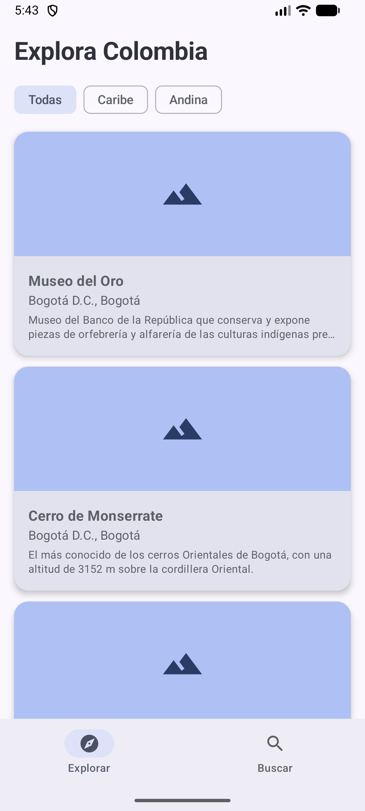 | 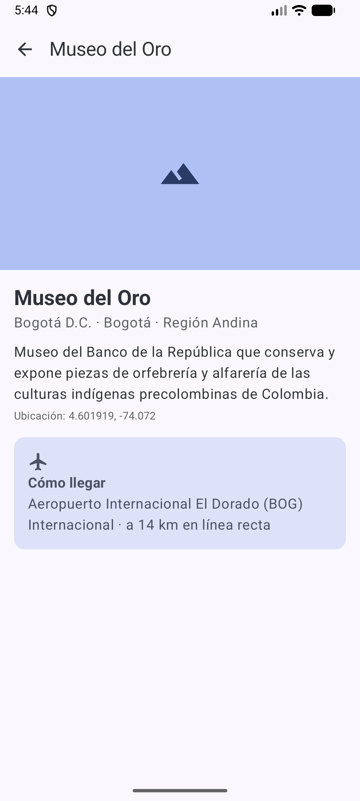 | 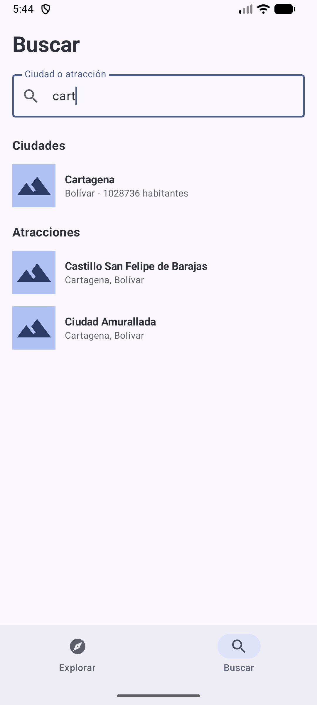 |

### Lo que falta (siguiente fase)

- Hacer que `RumboRepository` pida los datos con **Retrofit** que llame a los endpoints de la sección 4.
- Mostrar los estados **Cargando / Éxito / Error**.
- Cargar las fotos con **Coil** (por ahora se ve un ícono en su lugar).
- Guardar atracciones para ver sin internet con **Room**.
