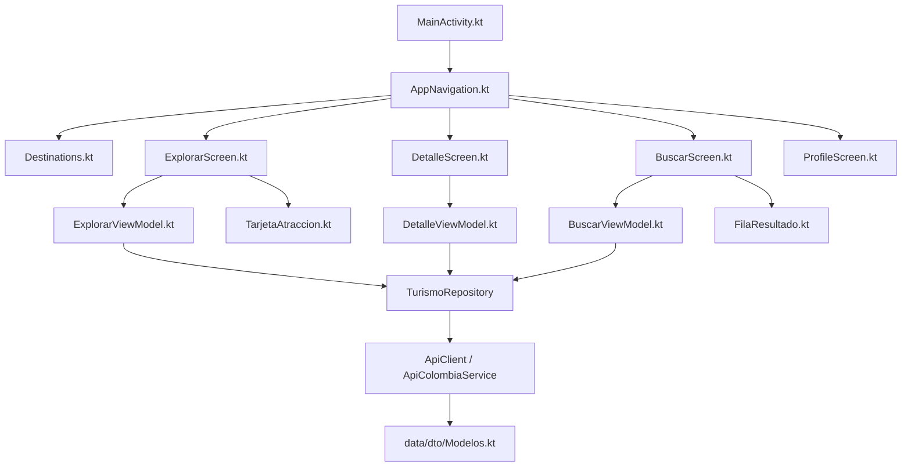

# Arquitectura y flujo de ejecución - Rumbo Colombia

Este documento explica cómo está organizado el código de la app, qué hace cada archivo y cómo se conectan entre sí.

## 1. Estructura del proyecto

```text
app/src/main/java/com/rumbocolombia/android/
│
├── data/                                <-- CAPA DE DATOS
│    ├── api/
│    │    ├── ApiClient.kt               (Retrofit + OkHttp + Kotlinx Serialization)
│    │    └── ApiColombiaService.kt      (endpoints de API Colombia)
│    ├── network/
│    │    ├── RetrofitClient.kt          (acceso a ApiClient desde data.network)
│    │    └── CargadorDeImagenes.kt      (Coil para las fotos)
│    ├── dto/
│    │    └── Modelos.kt                 (Region, Department, City, TouristicAttraction, Airport)
│    └── repository/
│         └── TurismoRepository.kt       (interfaz + TurismoRepositoryImpl)
│
├── presentation/                        <-- CAPA DE PRESENTACIÓN
│    ├── viewmodel/                      (estado de cada pantalla con StateFlow)
│    │    ├── ExplorarViewModel.kt
│    │    ├── DetalleViewModel.kt
│    │    ├── BuscarViewModel.kt
│    │    └── UiState.kt                 (Cargando / Exito / Error)
│    ├── navigation/                     (navegación type-safe con @Serializable)
│    │    ├── Destinations.kt
│    │    └── AppNavigation.kt
│    ├── screens/                        (pantallas en Jetpack Compose)
│    │    ├── ExplorarScreen.kt
│    │    ├── DetalleScreen.kt
│    │    ├── BuscarScreen.kt
│    │    ├── ProfileScreen.kt
│    │    └── EjemplosPreview.kt         (datos solo para los @Preview)
│    └── components/                     (componentes de UI reutilizables)
│         ├── TarjetaAtraccion.kt
│         ├── FilaResultado.kt
│         ├── FotoAtraccion.kt
│         ├── Cargando.kt
│         └── ErrorConReintentar.kt
│
├── docs/                                <-- DOCUMENTACIÓN DEL PROYECTO
│    └── tutorial_arquitectura.md
│
├── ui/theme/                            <-- TEMA (MATERIAL 3)
│    ├── Color.kt
│    ├── Theme.kt
│    └── Type.kt
│
└── MainActivity.kt                      <-- PUNTO DE ENTRADA
```

## 2. Cómo se conectan los archivos



## 3. Qué hace cada capa

- **data/dto:** las data class con `@Serializable`. Los campos se llaman igual que en el JSON de API Colombia.
- **data/api:** `ApiColombiaService` declara los endpoints con funciones `suspend`. `ApiClient` crea Retrofit con OkHttp (con logs en el Logcat) y Kotlinx Serialization.
- **data/repository:** la interfaz `TurismoRepository` dice qué datos se pueden pedir. `TurismoRepositoryImpl` hace las peticiones con `runCatching` y devuelve `Result`, así un error de red no cierra la app.
- **presentation/viewmodel:** cada pantalla tiene su ViewModel. Pide los datos al repositorio con `viewModelScope.launch` y guarda el estado en un `StateFlow` (`Cargando`, `Exito` o `Error`).
- **presentation/navigation:** las rutas son clases con `@Serializable` (`ExplorarScreen`, `DetalleScreen(attractionId)`, `BuscarScreen`, `ProfileScreen(username)`) y el `NavHost` las conecta con las pantallas.
- **presentation/screens y components:** las pantallas leen el estado con `collectAsState()` y lo dibujan usando los componentes.

## 4. Ejemplo del flujo completo: ver el detalle de una atracción

1. `MainActivity` carga `AppNavigation()` y se muestra `ExplorarScreen`.
2. `ExplorarViewModel` llama a `repositorio.obtenerAtracciones()`; mientras tanto la pantalla muestra `Cargando`.
3. `TurismoRepositoryImpl` hace `GET /TouristicAttraction` con Retrofit y devuelve `Result.success(lista)`.
4. En `onSuccess` el ViewModel cambia el estado a `Exito(lista)` y la pantalla dibuja una `TarjetaAtraccion` por cada atracción.
5. El usuario toca una tarjeta y se ejecuta `navController.navigate(DetalleScreen(attractionId = id))`.
6. `AppNavigation` recupera el id con `backStackEntry.toRoute()` y abre `DetalleScreen`.
7. `DetalleViewModel` pide `repositorio.obtenerDetalle(id)`: la atracción, su ubicación y el aeropuerto más cercano.
8. Si no hay internet, `onFailure` cambia el estado a `Error("Sin conexión a internet")` y se ve el botón **Reintentar**.
